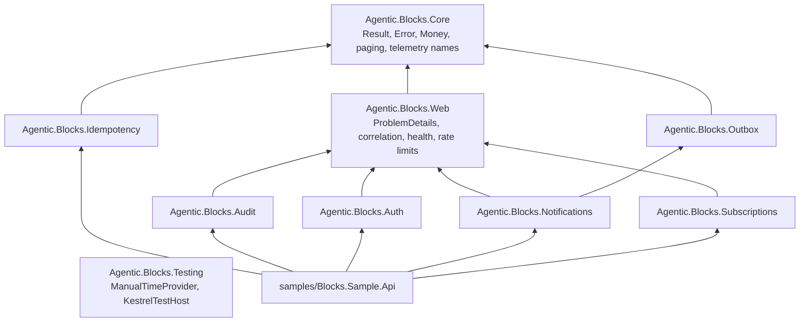

# Architecture

## Style and why
A set of independently versioned NuGet packages, each a small module with ports and in-memory adapters
(ADR-0001). Consumers compose them into a modular monolith; `arch-advisor compare` with this product's traits
recommends a modular monolith (complexity 3) and rules out microservices for a small team. Full reasoning: `docs/DESIGN.md`.

## Block dependencies

All blocks except Core and Testing also reference the `Microsoft.AspNetCore.App` shared framework.

## Modules and boundaries
| Block | Owns | Ports (swap these) | May call |
|---|---|---|---|
| Core | Result/Error, Money, cursor paging, IDomainEvent, ICorrelationContext, BlocksTelemetry | none | BCL only |
| Testing | ManualTimeProvider, KestrelTestHost | none | ASP.NET Core |
| Web | ProblemDetails mapping, correlation middleware, health, rate-limit policies, claims helpers | ICorrelationContext (impl) | Core |
| Idempotency | Idempotency-Key filter, request fingerprint, replay | IIdempotencyStore | Core |
| Outbox | Staging, commit, dispatcher, retry/backoff, dead letter | IOutboxStore, IOutboxHandler<T> | Core |
| Audit | Append-only hash-chained log, queries | IAuditStore | Core, Web |
| Auth | Register/login/refresh/logout/me, PBKDF2, lockout, demo seeding | IUserStore, IPasswordHasher | Core, Web |
| Notifications | Send, fan-out per channel, inbox, preferences, SignalR hub | IInboxStore, INotificationPreferenceStore, INotificationRecipientResolver, IEmailSender, ISmsSender, INotificationPusher | Core, Web, Outbox |
| Subscriptions | Plans, state machine, checkout, webhooks, entitlement filter | ISubscriptionStore, IPaymentProvider, ISubscriptionEventSink | Core, Web |

Rules: no block reads another block's stores; blocks identify users only through claims; cross-block reactions are
wired in the app (the sample's `NotifyAndAuditOnSubscriptionChange`).

## Cross-cutting
- **Errors**: `Result`/`Error` inside, RFC 9457 ProblemDetails at the edge with a stable `code`, `traceId`, `correlationId`.
- **Time**: always `TimeProvider`; tests use `ManualTimeProvider`.
- **Correlation**: `X-Correlation-Id` in, out, in the logging scope, on the Activity, on outbox messages and audit entries.
- **Telemetry**: ActivitySource/Meter `Agentic.Blocks.<Block>`; instruments `agentic.blocks.<block>.<name>`.
- **Security**: opaque data-protected bearer tokens, security-stamp revocation, rate-limited auth, HMAC-signed webhooks,
  masked personal data in logs.
