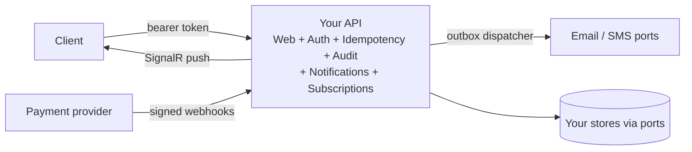

# Agentic Building Blocks

Teams rebuild login, subscriptions, notifications and idempotency on every project; these blocks give them a tested,
documented starting point they own.

Nine .NET 8 NuGet packages, **no third-party runtime dependencies** (BCL and the ASP.NET Core shared framework only),
239 focused tests, a sample API that wires everything, and a design dossier explaining every trade-off.

## Design at a glance
Each block is a small module with **ports** (interfaces it owns) and thread-safe **in-memory adapters** driven by
`TimeProvider`. You compose blocks into a modular monolith and replace adapters with your own (database, email
provider, payment provider, identity provider) without touching app code. Blocks talk only through Core types, standard
claims and outbox messages, so any one of them can later be moved into its own service. Why this shape, and what
changes at scale: [`docs/DESIGN.md`](docs/DESIGN.md) and [ADR-0001](.agentic/decisions/0001-framework-only-dependencies-and-ports-adapters.md).




## Run it in GitHub Codespaces

[](https://codespaces.new/Legion91919/agentic-building-blocks?quickstart=1)

The dev container installs the SDKs, restores packages and runs every test once on first start. The same setup works locally with VS Code's Dev Containers extension.

| What | Command | Port |
|---|---|---|
| Sample app (all blocks) | `ASPNETCORE_ENVIRONMENT=Development ASPNETCORE_URLS=http://0.0.0.0:5199 dotnet run --project samples/Blocks.Sample.Api` | 5199 |
| Smoke test (with the sample running) | `bash samples/smoke.sh` | - |
| All tests (same as CI) | `scripts/test-all.sh` | - |

## Blocks
| Package | Solves |
|---|---|
| `Agentic.Blocks.Core` | `Result`/`Error` instead of exceptions for expected failures; `Money` (decimal, ISO 4217, minor-unit rounding, same-currency arithmetic); keyset pagination; `IDomainEvent`; telemetry naming. |
| `Agentic.Blocks.Testing` | `ManualTimeProvider` with working timers; `KestrelTestHost` for real HTTP tests without extra packages. |
| `Agentic.Blocks.Web` | `AddBlocksWeb()`/`UseBlocksWeb()`: ProblemDetails from `Error` types, `X-Correlation-Id`, `/health/live` + `/health/ready`, rate-limit policies, `Result` to `IResult`. |
| `Agentic.Blocks.Idempotency` | `.RequireIdempotencyKey()`: replay on retry, 409 on key reuse with a different body, 400 without a key. |
| `Agentic.Blocks.Outbox` | Stage messages with your change; a background dispatcher delivers them with retry, back-off and dead letter. At least once. |
| `Agentic.Blocks.Audit` | Append-only, hash-chained audit log with queries by entity and actor. No update or delete. |
| `Agentic.Blocks.Auth` | `MapBlocksAuth("/auth")`: register, login, refresh, logout, me. PBKDF2 600k, lockout, roles, tenant claim, demo seeding. |
| `Agentic.Blocks.Notifications` | `INotificationService.SendAsync(...)` over in-app (inbox + SignalR), email and SMS, with per-category preferences, dispatched through the outbox. |
| `Agentic.Blocks.Subscriptions` | Plans and entitlements, a Trialing/Active/PastDue/Cancelled/Expired state machine, fake hosted checkout and signed webhooks, `.RequireEntitlement("hd")` returning 402. |

## Install
Packages are published to GitHub Packages on every `v*` tag.

```bash
dotnet nuget add source "https://nuget.pkg.github.com/OWNER/index.json" -n blocks -u USER -p TOKEN_WITH_READ_PACKAGES
dotnet add package Agentic.Blocks.Web --version 0.1.0
dotnet add package Agentic.Blocks.Auth --version 0.1.0
```

## Usage, one snippet per block
```csharp
// Core
Result<Money> Total(Money price, int qty) =>
    qty < 1 ? Error.Validation("order.qty", "qty", "Quantity must be positive.") : price * qty;

// Web
builder.Services.AddBlocksWeb();
app.UseBlocksWeb();
app.MapGet("/orders/{id}", (string id, Orders o) => o.Find(id).ToHttpResult());

// Idempotency
builder.Services.AddBlocksIdempotency();
app.MapPost("/orders", (NewOrder o, Orders s) => s.Place(o)).RequireIdempotencyKey();

// Outbox
builder.Services.AddBlocksOutbox().AddOutboxHandler<OrderPlaced, SendReceipt>("orders.placed.v1");
app.UseBlocksOutbox();                       // commit staged messages when the request succeeds
outbox.Enqueue(new OrderPlaced(orderId));

// Audit
builder.Services.AddBlocksAudit();
await audit.AppendAsync(new AuditRecord(userId, "order.refunded", "order", orderId, "damaged in transit"));

// Auth
builder.Services.AddBlocksAuth(o => o.QueryStringTokenPaths.Add("/notifications/hub"));
app.MapBlocksAuth("/auth");

// Notifications
builder.Services.AddBlocksNotifications(o => o.AddTemplate("welcome", "Welcome", "Hi {{name}}"));
app.MapBlocksNotifications("/notifications");
await notifications.SendAsync(userId, "general", "welcome", new Dictionary<string, string> { ["name"] = "Ada" });

// Subscriptions
builder.Services.AddBlocksSubscriptions(o => o.AddPlan("plus", "Plus", Money.Of(9.99m, "EUR"), BillingInterval.Monthly, 0, "hd"));
app.MapBlocksSubscriptions("/subscriptions");
app.MapGet("/media/hd", () => "stream").RequireEntitlement("hd");

// Testing
var clock = new ManualTimeProvider();
clock.Advance(TimeSpan.FromMinutes(15));
```
Each block has its own README in `src/<Package>/README.md` (shipped inside the package) with the full behaviour.

## Run the sample
```bash
ASPNETCORE_ENVIRONMENT=Development ASPNETCORE_URLS=http://localhost:5199 dotnet run --project samples/Blocks.Sample.Api
./samples/smoke.sh   # register, login, me, idempotent POST twice, 402 -> subscribe -> 200, inbox, logout
```

## Build and test
```bash
dotnet build AgenticBuildingBlocks.sln -c Release   # warnings are errors
dotnet test AgenticBuildingBlocks.sln -c Release
```
Offline workspaces: see `.agentic/runbook.md`.

## How this project is organised
`src/` packages, `tests/` one test project per block, `samples/` the sample API, `docs/DESIGN.md` the design dossier.
Project knowledge lives in the hidden `.agentic/` folder (start with `.agentic/README.md`); AI agents read `AGENTS.md` first.

## Licence
MIT
