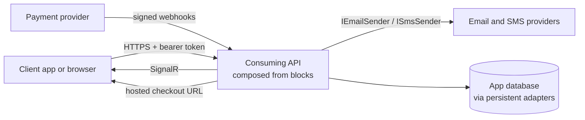
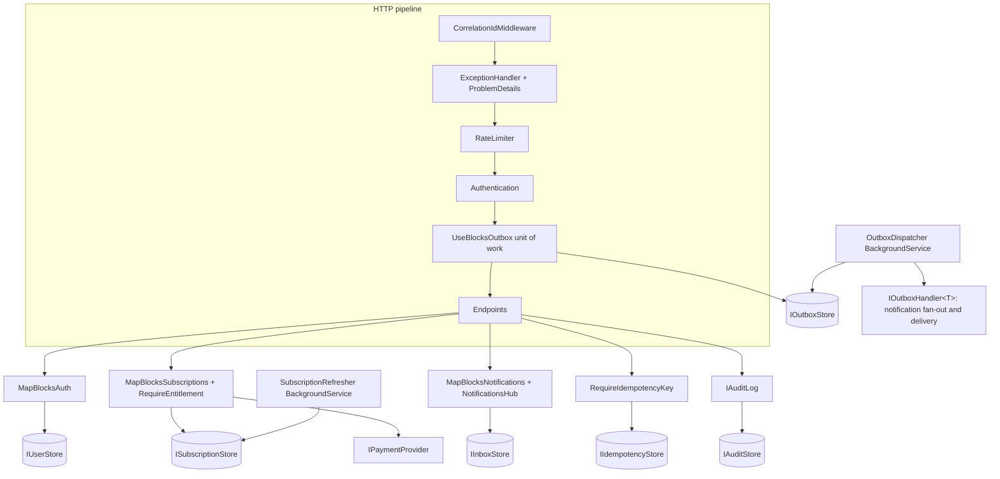
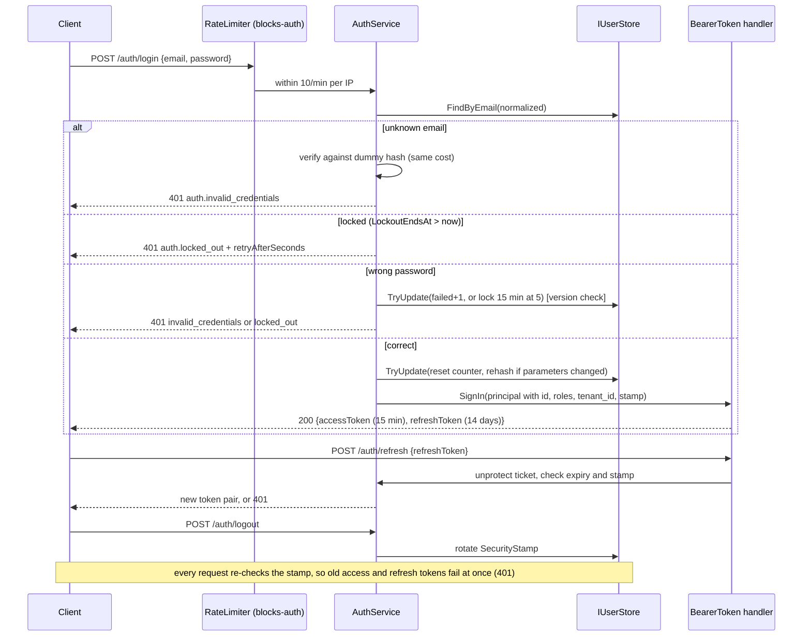
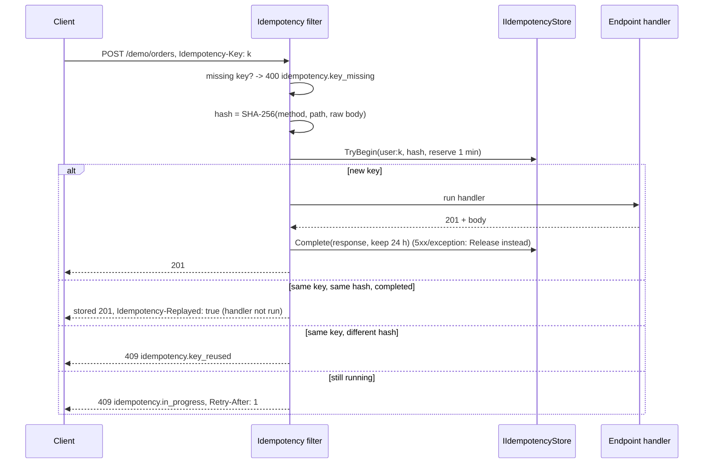
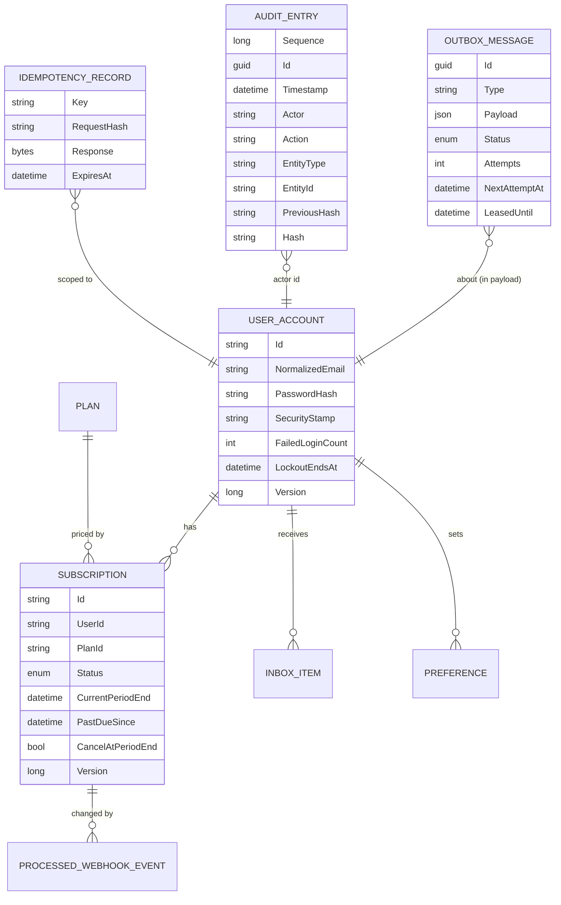

# Design dossier: Agentic Building Blocks

What was built, why this way, and what changes at 100x. Diagrams match the code in `src/` and `samples/`.

## 1. Brief
Teams rebuild login, subscriptions, notifications and idempotency on every project. These nine NuGet packages give
them a tested, documented starting point they own: `Core`, `Testing`, `Web`, `Idempotency`, `Outbox`, `Audit`,
`Auth`, `Notifications`, `Subscriptions`. Users are .NET engineers starting showcase or client APIs. Success: a new API
gets all of it in under an hour, with zero third-party runtime dependencies (see `.agentic/product.md`).

## 2. Requirements
**Functional** (one per block): Result/Error/Money/paging primitives; ProblemDetails, correlation, health and rate
limits; Idempotency-Key replay and conflict; transactional outbox with retry and dead letter; append-only audit;
email/password login with bearer and refresh tokens, lockout, roles, tenant claim; notifications over in-app, email and
SMS with preferences and live push; subscriptions with entitlements, a state machine, hosted checkout and webhooks.

**Non-functional**
| Need | Target | How |
|---|---|---|
| Dependencies | BCL + shared frameworks only | ADR-0001; FrameworkReference to `Microsoft.AspNetCore.App` |
| Correctness under retry | No duplicate side effects from client or provider retries | Idempotency keys, webhook event ids, idempotent handlers |
| Caller latency | A failing email/SMS provider adds 0 ms to the request | Outbox: requests only stage messages |
| Password storage | OWASP-level PBKDF2 | 600,000 iterations SHA-256, per-user salt, versioned format |
| Privacy | No personal data in logs beyond masked recipients | `PersonalDataMasker`, dev senders log length only |
| Testability | Time-dependent rules tested without sleeping | `TimeProvider` everywhere, `ManualTimeProvider` |
| Quality gates | Zero warnings; tests first | Warnings as errors, analyzers, 239 tests |

Capacity estimates and a data-flow diagram are left out: this is a library, and load depends on the consuming app.
Section 9 gives the per-block scaling path instead.

## 3. Options considered
`arch-advisor compare MoneyMovement RegulatoryAudit PersonalData ExternalPartnerIntegrations SeveralBusinessAreas SmallTeam MultiTenant`:

| Option | Fit | Complexity (1-5) | Main reason |
|---|---|---|---|
| Modular monolith | Recommended | 3 | Matches the recommended style. Money needs an append-only ledger and idempotency keys. |
| Modular monolith + CQRS read models | Good alternative | 3 | Same family; worth it when reads dominate. |
| Event-sourced core with CQRS | Good alternative | 4 | The event log would be the audit trail, but it is the hardest model to learn and evolve. |
| Layered / vertical-slice / Clean monolith | Poor fit | 1-2 | Several business areas tangle without module boundaries. |
| Serverless functions + queues | Poor fit | 3 | Money operations are awkward across stateless functions. |
| Microservices (sync or event-driven) | Poor fit | 5 | A small team cannot run a distributed system well. |

**Decision**: blocks are modules for a modular monolith, shipped as separate packages. Each owns its data behind a
port. A consumer can later move one block (for example notifications) into its own service: its only contracts are
outbox messages and claims. **Evolution trigger**: extract a block when it needs to scale or deploy on a different
schedule from the rest (notification fan-out at millions per day is the likely first).

**Per-block choices and trade-offs**

| Decision | Chosen | Rejected and why |
|---|---|---|
| Error handling | `Result<T>` + `Error` with a stable code, mapped to ProblemDetails at the edge | Exceptions for expected failures: invisible in signatures, costly, easy to leak messages |
| Money | `decimal` record with ISO 4217 validation, minor-unit rounding (banker's by default), same-currency arithmetic, `Allocate` | `double` (binary rounding errors); implicit conversion (wrong rate, hidden) |
| Paging | Opaque keyset cursors | Offset paging: duplicates and gaps while rows are inserted, slow at depth |
| Tokens | **Opaque, data-protected bearer tokens** from the built-in BearerToken handler; refresh tokens; revocation by security stamp | **JWT**: self-describing and verifiable by other services, but needs signing-key management and rotation, a JWT package, and cannot be revoked before expiry without extra state. Opaque tokens fit one app and no packages; the cost is that only this app (sharing the Data Protection key ring) can read them. Move to an OIDC provider issuing JWTs when several services must validate tokens (Auth README). |
| Logout | Rotate a security stamp, checked on each request and at refresh | Token blacklist (more state); short expiry only (logout not immediate) |
| Password hashing | PBKDF2-SHA256 (BCL), 600k iterations, rehash on login | Argon2id/bcrypt: stronger against GPUs but need packages; we keep a versioned format so the algorithm can change later |
| Idempotency | Endpoint filter + store with atomic reservation; fingerprint = method + path + raw body | Middleware for all POSTs (opt-out is riskier than opt-in); hashing bound arguments (misses raw-body differences) |
| Outbox delivery | **At least once**, idempotent handlers, per-channel fan-out | Exactly once (impossible across a network); in-request delivery (slow, couples caller to providers); a broker (one more system for a small team; an adapter can relay to one later) |
| Outbox unit of work | Staged per DI scope; committed by `UseBlocksOutbox` when the request succeeds, or by the dispatcher after a handler succeeds | Commit on every `Enqueue` (no atomicity with the business change) |
| Audit integrity | Gap-free sequence + SHA-256 hash chain, no update/delete API | Plain table (silent edits); event sourcing everything (too heavy for most apps) |
| Subscription logic | Pure state machine function; time-driven transitions applied lazily on read and by a refresher | Logic in endpoints (untestable); cron-only transitions (access wrong while the job is late) |
| Payments | Provider port + fake provider with real HMAC signatures | Calling a provider SDK from endpoints (lock-in, no offline tests) |
| Stores | **In-memory adapters**, thread-safe, `TimeProvider`-driven, behind ports | Shipping EF Core adapters now: ties every consumer to one ORM; packages blocked here. In-memory is lost on restart and single-instance, so it is for tests, demos and prototypes only. |

## 4. Architecture
### Context


### Containers (inside one consuming API)

Block dependencies are in `.agentic/architecture.md`.

## 5. Communication flows
### Login (and refresh, logout)


### Idempotent request


### Outbox dispatch (notification example)
```mermaid
sequenceDiagram
  participant E as Endpoint
  participant O as IOutbox (request scope)
  participant M as UseBlocksOutbox
  participant St as IOutboxStore
  participant D as OutboxDispatcher
  participant H1 as NotificationRequestedHandler
  participant H2 as NotificationDeliveryHandler
  E->>O: Enqueue(NotificationRequested)  [staged]
  E-->>M: 2xx
  M->>St: Commit staged messages (same transaction as the business change in a DB adapter)
  M->>D: wake signal
  D->>St: LeaseDue(now, 50, lease 1 min)
  D->>H1: handle (new DI scope)
  H1->>O: Enqueue(Delivery per enabled channel)
  D->>St: commit handler's messages, MarkSucceeded
  D->>H2: Delivery(Email)
  alt provider fails
    H2-->>D: throws
    D->>St: MarkFailed, next attempt = now + 2s * 2^(n-1) (cap 5 min, +/-20%)
    Note over D,St: after MaxAttempts: DeadLettered; other channels are unaffected
  else ok
    D->>St: MarkSucceeded
  end
```

### Subscription renewal (time and payment driven)
```mermaid
sequenceDiagram
  participant R as SubscriptionRefresher / any read
  participant SM as SubscriptionStateMachine
  participant St as ISubscriptionStore
  participant P as Payment provider
  participant K as ISubscriptionEventSink
  Note over R: now >= CurrentPeriodEnd, no payment yet
  R->>SM: Apply(TimePassed)
  SM-->>R: Active -> PastDue (PastDueSince = period end)
  R->>St: TryUpdate (version check)
  R->>K: OnChanged (sample: billing notification + audit)
  P->>R: webhook PaymentSucceeded (see next flow)
  R->>SM: Apply(PaymentSucceeded) -> Active, new period [now, now + 1 month]
  Note over SM: no payment within the 7-day grace period -> Expired (terminal); entitlements stop
```

### Webhook handling
```mermaid
sequenceDiagram
  participant P as Provider
  participant W as POST /subscriptions/webhooks/{provider}
  participant Pr as IPaymentProvider
  participant St as ISubscriptionStore
  participant S as SubscriptionService
  P->>W: body + signature header (rate-limited, anonymous)
  W->>Pr: ParseWebhook: HMAC-SHA256, timestamp within 5 min, constant-time compare
  alt bad signature
    W-->>P: 401 subscriptions.webhook_signature
  end
  W->>St: TryMarkEventProcessed(provider, eventId)
  alt already processed
    W-->>P: 200 {duplicate: true} (no side effects)
  else first time
    W->>S: apply (checkout -> create; payment ok/failed/cancelled -> state machine)
    alt processing fails
      S->>St: UnmarkEvent so the provider's retry is processed
      W-->>P: 4xx/5xx
    else ok
      W-->>P: 200 {duplicate: false}
    end
  end
```

## 6. Data model

Consistency: users and subscriptions use optimistic concurrency (`Version`); audit appends are serialized by the
sequence number; idempotency reservation and webhook-event marking must be atomic; notification delivery is eventually
consistent (seconds). Personal data: user email, recipient phone, inbox text. Money: plan prices (`Money`).

## 7. Scaling path (what breaks first, in order)
1. **In-memory stores**: lost on restart and not shared. First step for any real deployment: persistent adapters on the
   app database, plus a shared Data Protection key ring.
2. **Login CPU**: PBKDF2 at 600k iterations costs roughly 150-300 ms CPU per login. The auth rate limit caps abuse;
   scale out horizontally (stateless with shared keys and stores).
3. **Outbox polling**: one dispatcher per instance; leases make several instances safe. At high volume, relay outbox
   rows to a broker and let consumers scale independently; partition by message type.
4. **Per-request stamp check**: one user lookup per authenticated request; cache stamps for a few seconds, or move to an
   OIDC provider with short-lived JWTs.
5. **SignalR connections**: add a SignalR backplane (a distributed cache or a managed SignalR service) beyond one instance.
6. **Audit append contention**: one global sequence serializes writes. Shard chains per tenant or per entity type.

## 8. Failure modes
| Failure | Effect | Mitigation |
|---|---|---|
| Client retries a POST after a timeout | Could create a duplicate order or charge | Idempotency key replays the first response |
| Same key reused for a different request | Wrong response replayed | Fingerprint mismatch returns 409 |
| Email/SMS provider down | Notifications delayed | Outbox retries with back-off; other channels and the caller unaffected; dead letter after max attempts |
| Poison message (bad payload, no handler) | Endless retries | Dead-lettered at once; requeue after fixing |
| Crash after handler ran, before mark | Message delivered twice | At-least-once by design; handlers de-duplicate on `MessageId` (inbox de-dupes by notification id) |
| Provider sends a webhook twice | Double renewal | Event id recorded; duplicate returns 200 without side effects |
| Forged or replayed webhook | Fake activation | HMAC signature, 5-minute timestamp window, constant-time compare |
| Background refresher late or down | Access stays after expiry | Time transitions also run on every read |
| Credential stuffing | Account takeover | 10/min/IP rate limit, 5-failure lockout, generic errors, dummy hashing for unknown emails |
| Concurrent updates (two failed logins, two webhooks) | Lost updates | Version compare-and-swap with retry |
| Someone edits audit rows in storage | Silent history change | Hash chain; `/audit/verify` names the first broken sequence |
| Unhandled exception | Stack trace leak | ProblemDetails exception handler, generic message, correlation id for support |

## 9. Security and privacy
- **AuthN**: opaque data-protected bearer tokens (15 min) and refresh tokens (14 days); immediate revocation through
  the security stamp; query-string tokens accepted only on configured SignalR paths.
- **AuthZ**: roles as `role` claims, optional `tenant_id`; blocks check ownership (inbox items, checkout sessions).
  Self-registration cannot pick a role or tenant.
- **Passwords**: PBKDF2-SHA256 600k, 16-byte salt, 32-byte key, versioned, constant-time comparison, max length 128
  (bounds hashing cost), rehash on login.
- **Secrets**: none in the repo. The fake provider uses a random per-process secret; demo passwords are generated and
  printed once, in Development only. Production secrets belong in a secret store.
- **Personal data (POPIA/GDPR)**: dev email/SMS senders log only masked recipients and lengths; correlation ids and
  audit entries use ids, not names; `Reason` should be free text without personal data. Erasure and retention are
  implemented in the consumer's persistent adapters.
- **Abuse**: rate limits on auth and webhooks; idempotency keys scoped per user; correlation ids validated before echoing
  (no header injection).

## 10. Observability
- Traces and metrics follow `BlocksTelemetry`: sources/meters `Agentic.Blocks.<Block>`, subscribe with
  `AddSource("Agentic.Blocks.*")`. Outbox counters: `enqueued`, `dispatched`, `failed`, `dead_lettered`.
- Logs carry `CorrelationId` (and `OutboxMessageId` in the dispatcher) through the logging scope.
- SLIs/SLOs and the paging alerts are in `.agentic/quality.md`. The alert that wakes someone: dead letters rising or
  `/health/ready` failing.

## 11. Testing strategy
| Layer | What it covers here | Example tests |
|---|---|---|
| Rules (unit) | Money rounding and mismatch, paging, PBKDF2 format, the subscription transition table (25 rows), backoff maths, masking, templates | `MoneyTests`, `StateMachineTests.Transition_table`, `PasswordHasherTests` |
| Time | Lockout boundaries, key expiry, retry schedule, grace expiry, cancel at period end, token expiry | `Fifth_failure_locks_account_for_15_minutes`, `Failure_is_retried_after_exponential_backoff` |
| Concurrency | Exactly one idempotency owner, unique outbox leases, gap-free audit chain, counted parallel login failures | `Parallel_begins_have_exactly_one_owner`, `Concurrent_appends_produce_gap_free_valid_chain` |
| HTTP seams | Real Kestrel on loopback (`KestrelTestHost`): ProblemDetails, correlation, health, 429, replay/409/400, register/login/refresh/logout, 402 then 200, inbox endpoints, hub negotiate, webhook signature and dedupe | `Same_key_and_body_replays_stored_response`, `Entitlement_402_then_subscribe_then_200` |
| Journey | `samples/smoke.sh` against the running sample | Transcript in the release notes |

Every requirement in the brief maps to at least one named test; counts per block are in `.agentic/quality.md`.
CI runs the same tests with real xUnit and a 70% line-coverage gate.

## 12. Interview questions
1. **What if the payment webhook arrives twice?** The provider event id is recorded atomically before processing; the
   second delivery returns 200 `{duplicate: true}` and changes nothing. If processing fails, the id is released so the
   provider's retry is handled.
2. **Why opaque tokens and not JWT?** One app, no packages, no key rotation to manage, and logout is immediate via the
   security stamp. The trade-off is that other services cannot validate them; when that is needed, move to an OIDC
   provider issuing JWTs. App code only depends on claims, so no endpoint changes.
3. **How do you avoid charging twice when a client retries?** `RequireIdempotencyKey()` reserves the key atomically,
   stores the first response, replays it for the same fingerprint and returns 409 for a different body or while the
   first request is still running.
4. **Can the outbox deliver exactly once?** No system can across a network. It guarantees at least once and makes
   effects exactly once through idempotent handlers (de-dupe on `MessageId`, upserts, provider idempotency keys).
5. **A notification provider is down for an hour. What happens?** Requests are unaffected (they only stage messages).
   Each channel's delivery retries with exponential back-off up to 5 minutes apart; after 8 attempts it is dead-lettered
   and an alert fires; in-app and SMS still arrive.
6. **How is lockout tested without waiting 15 minutes?** `ManualTimeProvider`: five failures, advance 14:59 (still
   locked), advance 1 more second (login works).
7. **How would you scale this to 10x users?** Persistent adapters and a shared key ring first, then horizontal scale
   (stateless), a SignalR backplane, outbox relay to a broker, caching the stamp check, and sharding the audit chain.
8. **How do you swap the user store for an external identity provider?** Remove `AddBlocksAuth/MapBlocksAuth`, add the
   provider's handler, map claims with an `IClaimsTransformation`. Other blocks read `NameIdentifier`/`sub`, roles
   and `tenant_id` only.
9. **Why is subscription logic a pure function?** It makes the full transition table testable in a Theory, keeps time
   explicit, and lets reads apply time-driven transitions so access is right even if the background job is late.
10. **How would you detect tampering with the audit log?** Each entry hashes its fields with the previous hash; verify
    recomputes the chain and reports the first broken sequence. The database user should only have INSERT and SELECT.
